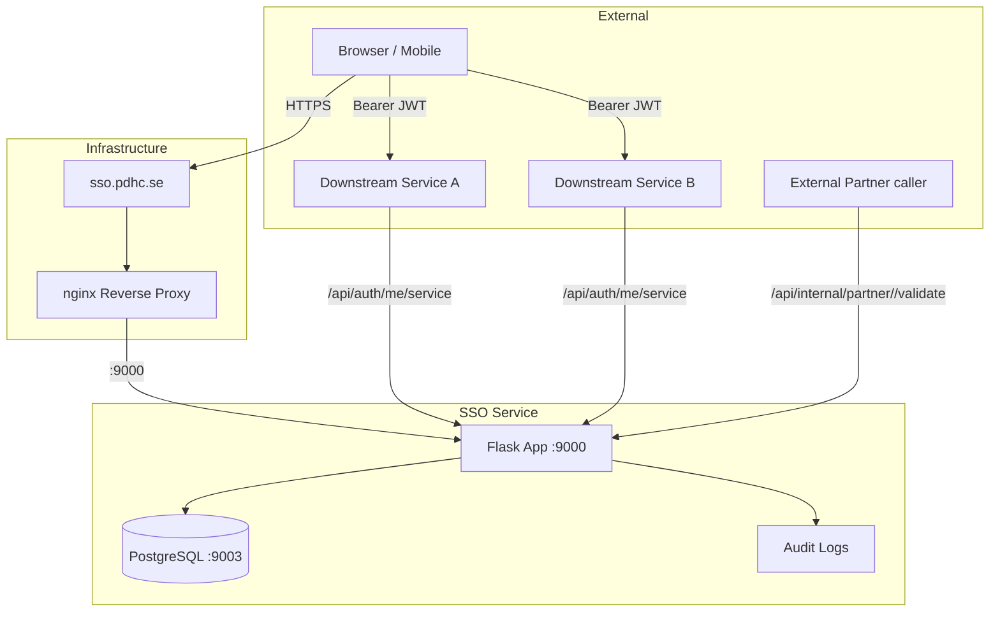
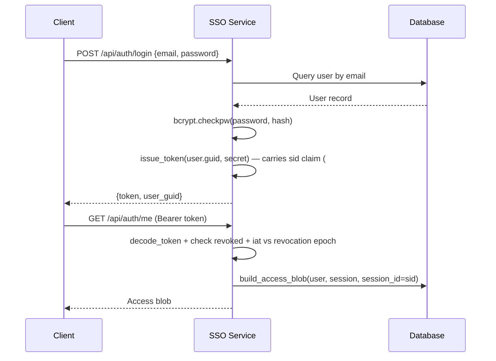
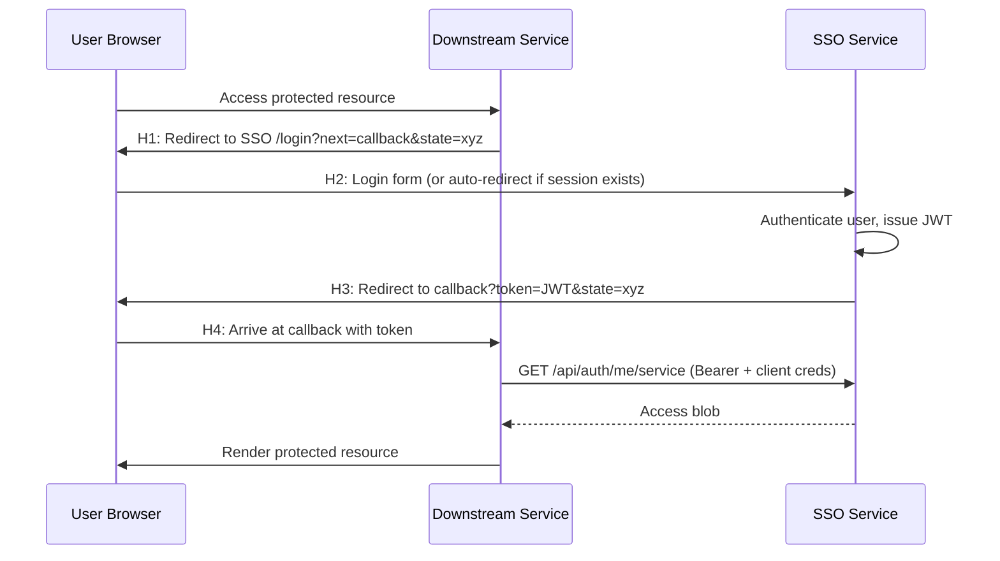
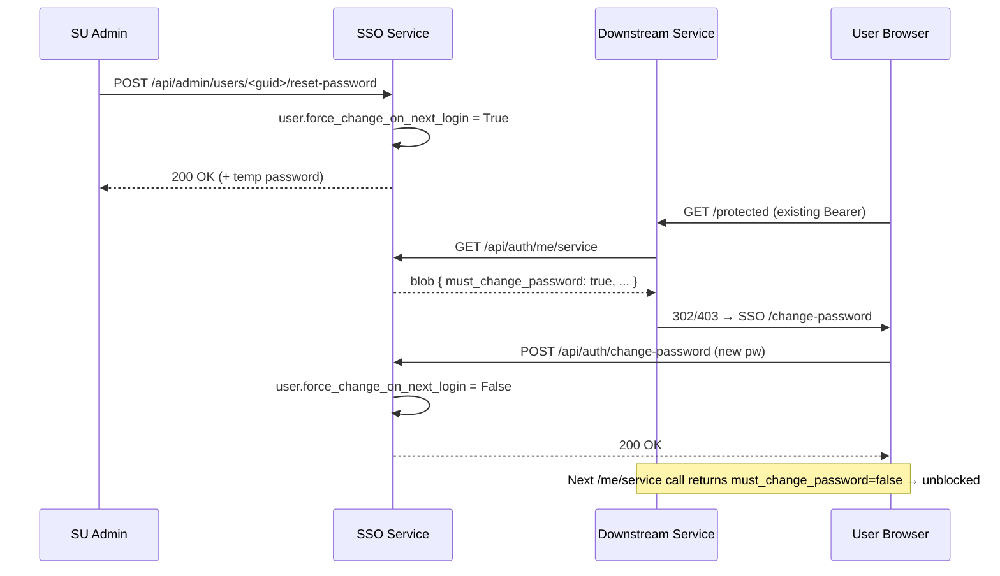
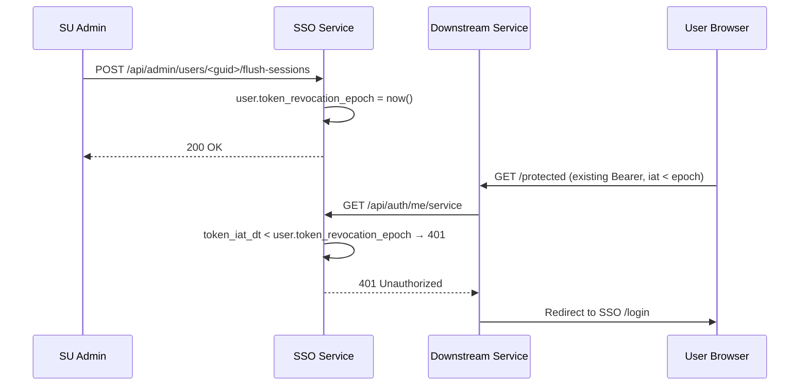
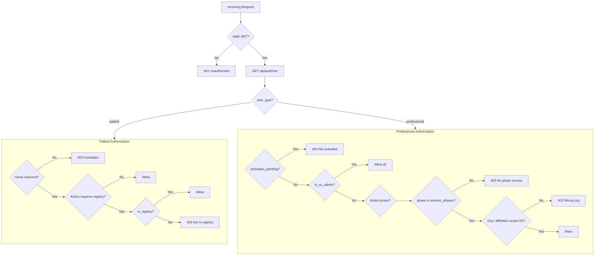

# Architecture Overview

This document describes the **current** SSO service after the access-model
reform (rollup #396: roles registry S2, research-project registry S4,
affiliation binding S3, session-phase intersection S5, blob assembly S6,
guided sign-on / activation gate S9, legacy-field kill-switch M0 #409).

## System Context



## Data Model

All tables use integer primary keys internally and UUID4 GUIDs for external
references (Rule 18). The live schema has **17 tables**. The access-model
reform added `roles`, `research_projects`, `affiliations`, and
`organisation_audit`; the pre-reform tables all remain (the reform dual-runs
`user_organisations` alongside `affiliations` until the M0 #409 cleanup).

| # | Table | Model | Purpose |
|---|-------|-------|---------|
| 1 | `users` | User | Login identity (patient or professional), SU flag, activation `status`, forced-reset + session-flush controls |
| 2 | `patients` | Patient | Patient profile, personnummer, org, registry status |
| 3 | `professionals` | Professional | Professional profile, name, legacy `professional_role` |
| 4 | `organisations` | Organisation | Internal orgs **and** external partners (single table, `is_external`); PDL caregiver hierarchy |
| 5 | `organisation_audit` | OrganisationAudit | Append-only org / partner lifecycle audit |
| 6 | `user_organisations` | UserOrganisation | Legacy person↔org M2M (backfilled into affiliations, kept until #409) |
| 7 | `groups` | Group | Organisational grouping; `category` is a free-form label only |
| 8 | `memberships` | Membership | person↔group membership with status + admin flag |
| 9 | `group_proposals` | GroupProposal | Professional-suggested new groups awaiting SU decision |
| 10 | `leader_requests` | LeaderRequest | Requests for group-admin role awaiting SU decision |
| 11 | `access_requests` | AccessRequest | New-professional onboarding requests |
| 12 | `invites` | Invite | Group invite tokens |
| 13 | `revoked_tokens` | RevokedToken | Per-`jti` token revocation (logout) |
| 14 | `user_phases` | UserPhase | Direct SU phase grants (source of `effective_phases`) |
| 15 | `roles` | Role | **Reform S2** — role registry (7 seed roles, each with a zone + permitted phases) |
| 16 | `research_projects` | ResearchProject | **Reform S4** — research-project (ResDB) registry |
| 17 | `affiliations` | Affiliation | **Reform S3** — person↔CareUnit↔Role binding; the heart of the reform |

```mermaid
erDiagram
    User ||--o| Patient : "has"
    User ||--o| Professional : "has"
    User ||--o{ UserPhase : "direct phase grants"
    User }o--o{ Organisation : "UserOrganisation (legacy)"
    User ||--o{ Affiliation : "person_guid"
    Organisation ||--o{ Affiliation : "care_unit_guid"
    Role ||--o{ Affiliation : "role_guid"
    Organisation ||--o{ Organisation : "parent_caregiver_guid"
    Organisation ||--o{ OrganisationAudit : "has"
    User }o--o{ Group : "Membership"
    Group ||--o{ Membership : "has"
    Group ||--o{ Invite : "has"
    User ||--o{ GroupProposal : "requests"
    User ||--o{ LeaderRequest : "requests"
    AccessRequest ||--o| User : "creates on approve"

    User {
        int id PK
        uuid guid UK
        string email UK
        string password_hash
        enum user_type "patient|professional"
        bool is_su_admin
        enum status "active|pending|suspended (#411 activation gate)"
        bool force_change_on_next_login "#43"
        datetime token_revocation_epoch "#44 nullable"
        datetime created_at
    }

    Affiliation {
        int id PK
        uuid guid UK
        uuid person_guid FK "= User.guid"
        uuid care_unit_guid FK "Organisation that is a CareUnit"
        uuid role_guid FK "Role"
        json research_project_guids "researcher only"
        bool is_admin
        enum status "active|suspended"
    }

    Role {
        int id PK
        uuid guid UK
        string code UK "doctor|nurse|other_care|researcher|..."
        string display_name
        enum zone "care|analysis"
        json permitted_phases "subset of phase names"
    }

    ResearchProject {
        int id PK
        uuid guid UK
        string name UK
        string description
        string ethics_ref "Etikprovningsmyndigheten dnr"
    }

    Organisation {
        int id PK
        uuid guid UK
        string name UK
        bool is_external "internal org vs external partner (#96)"
        uuid parent_caregiver_guid FK "NULL=caregiver, set=care unit (#187)"
        enum auth_kind "oauth_client|api_key|none (external)"
        string client_id "external"
        json allowed_scopes "external"
        json allowed_services "external"
        json allowed_org_guids "external"
        enum status "active|suspended|revoked (external)"
    }

    OrganisationAudit {
        int id PK
        uuid organisation_guid FK
        uuid actor_user_guid FK
        enum event "created|edited|rotated|suspended|reactivated|revoked"
        datetime at
        json before_json
        json after_json
    }

    UserPhase {
        int id PK
        uuid guid UK
        uuid user_guid FK "#46 direct phase grant"
        enum phase "planning|request|provider|analysis"
        uuid granted_by_guid
        datetime granted_at
    }

    Patient {
        int id PK
        uuid guid UK
        int user_id FK
        string personnummer "12 digits"
        uuid organisation_guid FK
        bool in_registry
        json registries
    }

    Professional {
        int id PK
        uuid guid UK
        int user_id FK
        enum professional_role "doctor|nurse|other (LEGACY; superseded by roles+affiliations)"
        string first_name
        string last_name
    }

    UserOrganisation {
        int id PK
        uuid user_guid FK
        uuid organisation_guid FK
    }

    Group {
        int id PK
        uuid guid UK
        string name
        string category "free-form label (#60) — does NOT confer phase access"
        datetime created_at
    }

    Membership {
        int id PK
        uuid guid UK
        uuid user_guid FK
        uuid group_guid FK
        enum status "pending|approved|rejected"
        bool is_admin
        uuid decided_by_guid
    }

    GroupProposal {
        int id PK
        uuid guid UK
        string proposed_name
        string category
        uuid requested_by_guid FK
        enum status "pending|approved|rejected"
    }

    LeaderRequest {
        int id PK
        uuid guid UK
        uuid user_guid FK
        uuid group_guid FK
        enum status "pending|approved|rejected"
    }

    AccessRequest {
        int id PK
        uuid guid UK
        string email
        enum professional_role
        uuid organisation_guid FK
        json requested_phases
        uuid chosen_leader_guid FK
        enum status "pending|endorsed|approved|rejected"
    }

    Invite {
        int id PK
        uuid guid UK
        uuid group_guid FK
        string token UK
        datetime expires_at
    }

    RevokedToken {
        int id PK
        string token_guid UK
        datetime expires_at
    }
```



### The reform triangle: Affiliation ⇄ Role ⇄ Organisation

- An **Affiliation** binds one **person** (`person_guid` = SSO user guid) to
  **one CareUnit** (`care_unit_guid` → an `organisations` row) in **one Role**
  (`role_guid` → a `roles` row). A person can hold several affiliations —
  e.g. Doctor at clinic A and Researcher at clinic B. Uniqueness is enforced
  per `(person, unit, role)`.
- The `roles` registry replaces the old 3-value `Professional.professional_role`
  enum. Seven seed roles ship, each carrying a **zone** (`care` | `analysis`)
  and a **`permitted_phases`** list:

  | code | display | zone | permitted_phases |
  |------|---------|------|------------------|
  | `doctor` | Doctor | care | request, provider, analysis |
  | `nurse` | Nurse | care | request, provider, analysis |
  | `other_care` | Other care professional | care | request, provider |
  | `researcher` | Researcher | analysis | analysis |
  | `quality_registry_reporter` | Quality registry reporter | analysis | analysis |
  | `local_quality_assured` | Local quality-assured | analysis | analysis |
  | `other_analysis` | Other analysis phase | analysis | analysis |

  The role list is SU-edit-only (S8 #410). The `planning` (Plan) phase is
  **orthogonal** — it touches no patient data, is on no role's
  `permitted_phases`, and passes the session intersection whenever granted.
- **ResearchProject** (ResDB) rows are referenced from an affiliation's
  `research_project_guids` (which projects a researcher works on). The
  analysis read is later intersected with the patient's consented projects in
  ips (D1).

### PDL caregiver hierarchy

`organisations` is self-referential via `parent_caregiver_guid`:

- `NULL` → this row **is a caregiver** (vårdgivare / legal data holder) — a
  **CareOrganisation**.
- non-`NULL` → this row is a **vårdenhet / clinic** (a **CareUnit**) whose
  parent caregiver is the pointed-at guid.

`Organisation.care_organisation_guid` resolves a CareUnit up to its caregiver
(or returns its own guid when it is already a caregiver). This is what powers
the caregiver roll-up in the access blob (#188, PDL Ch 4 §§2,4).

### FHIR Resource Mapping

| Table | FHIR Resource Type |
|-------|-------------------|
| Patient | Patient |
| Professional | Practitioner |
| Organisation | Organization |
| Group | Group |

External partners deliberately share the `Organisation` table so that
`Contract.signer.party.reference = Organization/<guid>` works uniformly across
internal payers and external providers (#96).

### Patient-app tables (#1040)

All NEW tables; no existing table was altered. Created by
`scripts/init_db.py` (`create_all`, additive, idempotent). This repo has no
Alembic.

| table | holds |
|---|---|
| `webauthn_credentials` | one row per passkey: `credential_id` (unique), public key, `sign_count`, name |
| `totp_secrets` | at most one per user: `secret_enc`, `confirmed_at` (NULL = not enrolled), `last_used_step`, `failed_attempts`, `locked_until` |
| `patient_links` | the current link: `user_guid` (unique), `ips_patient_guid` (unique), `care_unit_guid`, `linked_by_user_guid`, `linked_at`, `method` |
| `patient_link_history` | append-only: `event`, account, patient, previous patient, actor, method, reason, `at` |
| `patient_invites` | `token_hash`, `ips_patient_guid`, `care_unit_guid`, creator, `expires_at`, `used_at`, `revoked_at` |
| `patient_link_codes` | `user_guid`, `code_hash`, `expires_at`, `used_at`, `used_by_user_guid` |
| `login_lockouts` | one row per user that has failed a password login: `failed_count`, `last_failed_at`, `locked_until` |
| `patient_profiles` | #1049: one row per self-registered patient: `user_guid` (unique), `given_name`, `family_name` (for the blob's `display_name`). The mobile number is NOT stored in SSO; it goes to eps |

`patient_links.care_unit_guid` existed from #1040 (invite unit, link-code unit);
#1049 exposes it in the blob and sets it at self-registration. Rows written
before carry the unit they were made for, or null (SU relink without a unit).

## Authentication Flow

### Standard Login



### Password lockout (#1040)

`auth_service.authenticate_user` is the one place a password login is decided;
the HTML form and `POST /api/auth/login` both call it. Since #1040 it also
holds the lockout (`services/login_lockout.py`, table `login_lockouts`):

| rule | value |
|---|---|
| lock after | 5 consecutive wrong passwords |
| lock lasts | 15 minutes, then ends by itself |
| counter resets | on a successful login; a failure older than 15 minutes no longer counts |
| while locked | the right password is refused; attempts are neither counted nor extend the lock |
| escalation | none. Time-based only, never permanent — also for an SU admin |
| stored | in the database (two gunicorn workers; an in-memory counter would double the attempts and forget them at restart) |

**No enumeration.** `authenticate_user` returns `None` for an unknown email, a
wrong password and a locked account alike, so both doors give the same status
and message for all three; and bcrypt is run in all three (against a dummy
hash for an unknown email), so they cost the same. An unknown email creates
no row. The reason is in the audit log only: `login_locked`,
`login_refused_locked`. An SU sees and ends locks via `/api/admin/login-locks`
and `/api/admin/users/<guid>/unlock-login`.

**What it does not stop:** re-locking a known account every 15 minutes with
five wrong passwords. That is inherent in a lock keyed on the account.

The TOTP lock on the second step (below) is separate and unchanged.

### Patient login: password, then a second factor (#1040)

A `patient` account has a second factor: a **passkey** (WebAuthn, via the
`webauthn` library) first, **TOTP** (via `pyotp`) as reserve. Professionals are
unchanged in this stage.

```mermaid
sequenceDiagram
    participant B as Browser
    participant S as SSO Service
    B->>S: POST /login (email, password [, next, state])
    alt a factor is enrolled
        S-->>B: 302 /login/second-factor — NO token; session holds sf_pending
        B->>S: passkey assertion  or  TOTP code
        S->>S: issue_token(..., second_factor={method, verified_at})
    else nothing enrolled yet
        S->>S: issue_token(...) — no claim
        S-->>B: 302 /second-factor (enrol)
        B->>S: register passkey  or  confirm TOTP
        S->>S: re-issue the session token WITH the claim
    end
    S-->>B: 302 to the service callback (allow-listed) or /dashboard
```

**`verified` is a property of the token, not of the account.** The claim pair
`sfm` (method) / `sfa` (when, epoch seconds) is written only by
`issue_token(..., second_factor=...)`. `build_access_blob` reads it from the
token that carried the request. So an enrolled account that obtains a token
with the password alone — `POST /api/auth/login` still issues one — gets
`second_factor.verified: false`. **This is a delegated control**, like
`must_change_password`: SSO states the fact, the consumer refuses on it.
patientapp.pdhc is the consumer that does.

What SSO itself enforces:

| rule | where |
|---|---|
| a patient's token reaches a service callback only when the session token is verified; an unverified session is sent to enrol / step up and resumes afterwards | `second_factor_ui.patient_handshake`, `begin_patient_login` |
| the claim is carried from the session token onto the token minted for a service | `patient_handshake` |
| adding or removing a factor on an enrolled account needs a verified session | `_may_change_factors`, `remove_factor` |
| the last factor cannot be removed by the user | `second_factor.remove_factor` |
| a passkey assertion is matched to a credential of THIS user | `finish_authentication` |
| a WebAuthn challenge is consumed before it is checked (one attempt) | `login_passkey_verify`, `enrol_passkey_verify` |
| TOTP: a code works once (the 30 s step is remembered); 5 wrong codes lock TOTP for 15 minutes | `second_factor._check_code` |
| lost device: SU reset removes every factor and ends all sessions | `POST /api/admin/users/<guid>/second-factor/reset` |

**Trust on first use, stated.** An account with no factor enrols one with its
password alone. For an invited account the one-time invite link is what binds
the person; for a self-registered one, the link code handed to the care unit
is. The SU reset re-opens that window, so it is the one operation where the SU
must have checked who is asking.

**Configuration.** Passkeys are bound to one site: `WEBAUTHN_RP_ID` and
`WEBAUTHN_ORIGIN` (production `sso.pdhc.se` / `https://sso.pdhc.se`). There is
no fallback; unset, the passkey endpoints answer `503 passkey_not_configured`
and TOTP still works. Deriving the site from the request's Host header was
rejected: whoever controls that header would choose what a credential is
verified against. Changing the RP ID orphans every registered passkey.

**Secrets at rest** (`services/secret_store.py`):

| what | how | why |
|---|---|---|
| passkey | only the PUBLIC key is stored | the private key never leaves the device |
| TOTP shared secret | Fernet-encrypted | cannot be hashed: the server computes the code from it. First encryption-at-rest in this repo |
| patient-invite token (256 bits) | keyed hash (HMAC-SHA256) | shown once, never stored |
| link code (8 characters, about 39 bits) | keyed hash (HMAC-SHA256) | a plain hash of so short a value could be searched offline from a database dump; keyed, a dump alone is not enough |

Both keys are derived from `SECRET_KEY` (HKDF, one label per purpose), so
there is no new `.env` variable. **Rotating `SECRET_KEY` therefore makes
enrolled TOTP secrets unreadable** (those patients enrol again; passkeys are
unaffected) and voids outstanding invites and link codes.

### Patient link: which patient an account is (#1040)

`patient_link` in the blob names the patient GUID from eps.pdhc (formerly
ips.pdhc) — the `patient_guid` on ServiceRequests and CDR rows. It is `null`
until care has linked the account. Two entrances, one link step
(`services/patient_link._set_link`):

1. **Invited by care.** A professional creates a *patient invite* naming the
   eps patient guid and a care unit. The patient opens the one-time link
   (`/patient-invite/<token>`, 7 days), enters email, personnummer and a
   password; the account is created already linked.
2. **Self-registered** (#1049, contract s7.1). The patient registers
   (`/register-patient`, or `POST /api/patient/register`); SSO asks eps to
   create the patient (`POST /api/v1/patients/self-register`). eps `201` ->
   the account is created AND linked in one transaction (`method`
   `self_register`, `linked_by` `self-registration`, the chosen unit). eps
   `409` (eps already knows the number) -> the account is created UNLINKED and
   the patient continues as below; it is never auto-linked, or anyone could
   take over an existing patient by typing a number. Unlinked, the patient logs in,
   and asks for a **link code** (`ABCD-EFGH`, one-time, 7 days, only the newest
   works). The patient gives it to the care unit; a professional there enters
   the code together with the eps patient guid.

| rule | detail |
|---|---|
| who may link | an **activated** professional with an **active affiliation** to the care unit (the invite's unit; for a code, the unit the patient registered at), or an SU admin. A professional with `must_change_password` is refused |
| one account ↔ one patient | both directions, by unique constraints on `patient_links` and by check |
| relink / unlink | SU admin only, with a reason |
| no oracle | redeeming an unknown, used, expired code, or a valid code of another unit's patient, answers the same `404 link_code_not_found`; a failed attempt does not burn the code |
| history | `patient_link_history` is append-only (link / relink / unlink, who, when, why). The audit FILE has 90-day retention; this does not |

#### The eps check (`services/eps_client.py`)

A wrong guid would show one patient another patient's tasks, so the guid is
checked against eps.pdhc at each of the three points where one enters: invite
creation, link-code redemption, SU relink.

```
GET {EPS_BASE_URL}/api/v1/patients/<guid>/clinics
Authorization: ApiKey <EPS_API_KEY>
```

The guid must exist in eps **and** the patient must be listed at the care unit
the link is made for (the invite's unit; for a code, the unit the patient
registered at). For an SU relink, existence is required and the unit check
applies when the request names `care_unit_guid`.

**Identifier spaces, verified in eps's model.** Each clinic eps returns has two
guids: `guid` is eps's own clinic row id and is *not* an SSO identifier;
`organisation_guid` — repeated as `care_unit_guid` — is "the sso organisation
this clinic IS". SSO's care-unit guid is an `organisations.guid`, so it is
compared with `care_unit_guid` and never with `guid`. A clinic in eps that has
no `organisation_guid` can match no unit.

**Fails closed, by name.** Nothing is written on any of these — no invite, no
link, no history row — and a failed redemption does not burn the link code.

| code | HTTP | when |
|---|---|---|
| `eps_not_configured` | 503 | `EPS_BASE_URL` or `EPS_API_KEY` unset. There is no default URL |
| `eps_unavailable` | 503 | no answer, timeout, 401/403 (SSO's key is wrong), 3xx, 5xx, a 200 that is not a list, or a 404 that is not eps's own `{"error": "Patient not found"}` |
| `patient_not_found` | 404 | eps's own 404 |
| `patient_not_at_unit` | 409 | the patient exists, but no active clinic is that unit |

A refusal or an outage is never read as "patient not found" and never as "ok".
The 404 rule is deliberate: a hostname the reverse proxy does not know falls
through to another service, which answers 404 for any path.

**No leak outside the gate.** eps is asked only after the caller has passed the
affiliation / SU gate (and, for a code, holds a valid code). Someone who may
not link gets the same answer whether the guid exists or not, and eps is not
called at all. Every refusal is audited as `patient_link_refused` with the
real reason.

**Development opt-out.** `EPS_LINK_CHECK_DISABLED=true` skips the call, only
when `FLASK_ENV=development` — the switch that already relaxes the session
cookie. `create_app` refuses to start with the flag set under any other
`FLASK_ENV`, and the run-time check ignores it there as well. A skipped check
is audited (`patient_link_eps_check_skipped`).

!!! warning "What this check still cannot see"
    - **Accepting an invite does not ask eps again.** The guid was checked when
      the invite was created, up to seven days earlier.
    - **eps's `/clinics` route does not filter ended assignments** (it joins
      `patient_clinic_assignments` without `ended_at IS NULL`), so a patient
      who has LEFT a unit still counts as listed there until eps is changed.
    - **eps accepts the patient's FHIR `resource_id` as well as the platform
      guid** on that route and does not echo which one it matched. A
      `resource_id` entered by mistake passes the check and is stored; the
      patient app then finds no tasks for it (it fails empty, not onto another
      patient).

This is not `models/invite.py`: that `Invite` is a GROUP-join token for
professionals (and stores its token in clear). It was not reused.

### SSO Handshake (H1–H4)

Used by downstream services to authenticate users through the central SSO.



**Security controls:**

- `next` URL validated against the `ALLOWED_CALLBACK_URLS` allowlist.
- `state` parameter passed through for CSRF protection.
- Auto-redirect skips the login form if the user already has a valid session.
- Service-to-service calls to `/api/auth/me/service` require
  `X-SSO-Client-Id` and `X-SSO-Client-Secret` headers. These are matched
  against `SERVICE_CREDENTIALS`, a `{client_id: secret}` map assembled at
  startup from `SSO_CLIENT_ID_<NAME>` / `SSO_CLIENT_SECRET_<NAME>` env pairs
  (`config.py`). A missing or mismatched pair returns **403**.

### Forced Password Reset (#43)



### Bulk Session Flush (#44)



Cheaper than inserting N revoked-token rows when the set of active `jti`s is
unknown (e.g. after a credential compromise across multiple devices).

### Service-credential compare is constant-time

`/api/auth/me/service` is the endpoint **every** downstream service calls to
validate a token, on every request (Rule 11 forbids caching the blob). Its
credential check used `service_creds.get(client_id) != client_secret`, whose
run time depends on how many leading bytes match — a timing oracle on the
client secret, on the one route guaranteed to be callable at high volume.

It now uses `hmac.compare_digest`, matching the pattern already in
`auth_middleware`. Both sides are encoded to bytes first, so a non-ASCII header
returns 403 rather than raising.

## Access Blob Schema

The access blob is the core data structure returned by `/api/auth/me` and
`/api/auth/me/service` (`build_access_blob` in `services/auth_service.py`).
Downstream services use it to make authorization decisions.

### Common identity fields (all users)

| Field | Meaning |
|-------|---------|
| `user_guid` | Stable person identity |
| `email` | Login email |
| `user_type` | `patient` \| `professional` |
| `is_su_admin` | Super-user flag (bypasses phase/org gates) |
| `must_change_password` | Forced-reset pending (#43) |
| `session_id` | The `sid` claim from the JWT carrying the request (#191). Stable across every `/me` / `/me/service` call for the same token. Consumers forward it as `X-Operator-Session-Id` so downstream audit logs can correlate all reads under one operator session (Lag 2022:913 chain-of-custody). `null` for pre-#191 tokens. |

### Patient Access Blob

```json
{
  "user_guid": "a1b2c3d4-...",
  "email": "patient@example.com",
  "user_type": "patient",
  "is_su_admin": false,
  "must_change_password": false,
  "session_id": "sess-...",
  "patient_guid": "e5f6g7h8-...",
  "organisation_guid": "i9j0k1l2-...",
  "in_registry": true,
  "registries": ["INCA"],
  "fhir_resource_type": "Patient",
  "patient_link": {
    "ips_patient_guid": "<eps patient guid>",
    "linked_at": "2026-11-22T09:15:00+00:00",
    "linked_by": "<user guid of the professional or SU, or \"self-registration\">",
    "care_unit_guid": "<care unit guid or null>"
  },
  "display_name": "Anna Andersson",
  "second_factor": {
    "enrolled": true,
    "verified": true,
    "method": "passkey",
    "verified_at": "2026-11-22T09:20:11+00:00"
  }
}
```

| Field | Meaning (#1040) |
|-------|---------|
| `patient_link` | `null` until care has linked the account to a patient. Always present for a patient |
| `patient_link.care_unit_guid` | #1049: the unit chosen at registration, the invite's unit, or (link code) the unit the patient registered at; `null` for an SU relink without a unit |
| `display_name` | #1049: `given_name family_name` from self-registration; `null` when SSO has no name (invited and older accounts). Patients only |
| `second_factor.enrolled` | The ACCOUNT has at least one passkey or a confirmed TOTP secret |
| `second_factor.verified` | THIS token was issued after a second factor was presented. `false` for a password-only token, even on an enrolled account |
| `second_factor.method` | `"passkey"` or `"totp"` when verified, else `null` |
| `second_factor.verified_at` | ISO-8601 UTC when verified, else `null` |

A consumer that serves patient data requires **all** of: `user_type ==
"patient"`, `second_factor.verified`, `must_change_password` false, and
`patient_link.ips_patient_guid` present. SSO does not enforce this for the
consumer. `patient_guid` (SSO's own Patient row) is NOT the eps patient guid.

### Professional Access Blob (current / reform)

```json
{
  "user_guid": "m3n4o5p6-...",
  "email": "doctor@hospital.se",
  "user_type": "professional",
  "is_su_admin": false,
  "must_change_password": false,
  "session_id": "sess-...",
  "professional_guid": "q7r8s9t0-...",
  "fhir_resource_type": "Practitioner",

  "activation_pending": false,
  "affiliations": [
    {
      "affiliation_guid": "aff-...",
      "care_unit_guid": "unit-...",
      "care_unit_name": "Oncology Clinic",
      "care_organisation_guid": "caregiver-...",
      "care_organisation_name": "Region Example",
      "role": "doctor",
      "role_guid": "role-...",
      "is_admin": false,
      "research_project_guids": []
    }
  ],
  "active_affiliation_guid": "aff-...",
  "session_phases": ["analysis", "request"],

  "professional_role": "doctor",
  "organization_ids": ["unit-..."],
  "organisation_warning": false,
  "organization_caregivers": { "unit-...": "caregiver-..." },
  "groups": [
    {
      "group_guid": "u1v2w3x4-...",
      "group_name": "Oncology Planning",
      "category": "planning",
      "status": "approved",
      "is_admin": false
    }
  ],
  "effective_phases": ["analysis", "planning", "request"]
}
```

#### The fields that matter now

- **`affiliations[]`** — the person↔CareUnit↔Role bindings (only `status =
  active` are listed). Each entry resolves the CareUnit up to its
  CareOrganisation and names the role.
- **`active_affiliation_guid`** — the affiliation the current session is
  acting under. Defaults to the sole affiliation when the person has exactly
  one; otherwise `null` (the session selects one via the S9 acting-as flow).
- **`session_phases`** — **this is the field services must gate on now.** It
  is the runtime intersection

  ```
  session_phases = granted_phases ∩ ( active_role.permitted_phases ∪ {planning} )
  ```

  computed by `resolve_session_phases` (S5, Option C). `granted_phases` are the
  raw `UserPhase` grants; the active role narrows them. When there is no active
  role, only orthogonal (`planning`) phases pass.
- **`activation_pending`** — `false` for an activated professional. See the
  activation gate below.

#### Activation gate (S9 #411)

An **unactivated** professional (`User.status != "active"`) receives a
**NO-ACCESS blob** regardless of any granted phases: identity fields are
present, but every scope/phase field is empty and `activation_pending: true`:

```json
{
  "activation_pending": true,
  "affiliations": [],
  "active_affiliation_guid": null,
  "session_phases": [],
  "organization_ids": [],
  "organisation_warning": true,
  "organization_caregivers": {},
  "groups": [],
  "effective_phases": []
}
```

Granting phases is **not** enough — an SU must explicitly **ACTIVATE** the
account (`POST /api/admin/users/<guid>/activate`), which is refused with a
`409 + missing[]` list until the profile is complete (≥1 active affiliation, at
least one granted phase the held role can actually use, and every researcher
affiliation carrying ≥1 research project). This replaces the after-the-fact
`organisation_warning` flag with an up-front gate, so every consumer's existing
phase/org check denies an unactivated user with no consumer-side change.

#### Legacy dual-emitted fields (kill-switch, M0 #409)

For backwards compatibility the blob still emits the pre-reform fields
**alongside** the reform ones. These are gated by the
`SSO_EMIT_LEGACY_BLOB_FIELDS` environment switch (default **`true`**). When it
flips to `false`, the following keys **disappear** from professional blobs:

```
organization_ids, organisation_warning, organization_caregivers,
professional_role, groups, effective_phases
```

(`LEGACY_BLOB_FIELDS` in `auth_service.py`.) The switch can be flipped back to
re-emit instantly. Notes:

- `effective_phases` is the **raw** `UserPhase` grant set (not role-narrowed) —
  services must move to `session_phases`, which is the reform equivalent.
- `professional_role` is the single legacy role string; the reform equivalent
  is the per-affiliation `role`.
- `organization_ids` / `organization_caregivers` come from the legacy
  `user_organisations` M2M and the caregiver roll-up (#188); the reform
  equivalent is `affiliations[].care_unit_guid` /
  `affiliations[].care_organisation_guid`.
- `groups` remains available while the switch is on but was always orthogonal
  to access — `Group.category` is a free-form label and confers no phase (#57,
  #60).

### Partner access blob (external callers)

`POST /api/internal/partner/<guid>/validate` (service-key protected) validates
an external partner's credential and returns a distinct blob shape:

```json
{
  "access_blob": {
    "user_type": "partner",
    "partner_guid": "org-...",
    "organisation_guid": "org-...",
    "display_name": "Acme Integrations",
    "allowed_scopes": ["fhir.observation.read"],
    "allowed_services": ["cdr.pdhc"],
    "allowed_org_guids": ["..."],
    "is_su_admin": false,
    "organization_ids": ["..."]
  }
}
```

## Decision Tree

Downstream services use the access blob to authorize actions. Post-reform, the
professional phase check is against **`session_phases`**:



## Endpoint Map (blueprints)

| Blueprint | Prefix | Purpose |
|-----------|--------|---------|
| `auth` | `/api/auth` | `login`, `me`, `me/service`, `logout`, `change-password` |
| `patient` | `/api/patient` | Patient self-service |
| `patient_access` | `/api` | #1040, Bearer: `POST /patient/link-code`; `POST /patient-links/invites`, `DELETE /patient-links/invites/<guid>`, `POST /patient-links/redeem`; SU `PUT`/`DELETE /admin/patient-links/<user_guid>`, `POST /admin/users/<guid>/second-factor/reset`; `GET /auth/second-factor` |
| `second_factor_ui` | — | #1040, session cookie + CSRF: `/login/second-factor[/passkey/options|/passkey/verify|/totp]`, `/second-factor[/passkey/options|/passkey/verify|/totp/start|/totp/confirm|/remove]`, `/patient-invite/<token>`, `/patient-link/code|invite|redeem` |
| `groups` | `/api/groups` | Membership / admin / invite flows |
| `admin` | `/api/admin` | SU administration (see below) |
| `registry` | `/api/registry` | Roles, research-projects, care-organisations, care-units |
| `public` | `/api/public` | Unauthenticated lookups + access-request + partner lookup |
| `internal` | — | Service-key internal endpoints (push-config, partner validate) |
| `partners` | — | External-partner subsystem (`/api/admin/partners/*`, etc.) |
| `frontend` | — | Server-rendered pages + service-key admin |
| `fhir` | — | Capability statement |

### SU admin surface (`/api/admin`)

- **Users:** `GET /users`, `POST /promote-su`, `DELETE /users/<guid>`,
  `POST /users/<guid>/reset-password`, `POST /users/<guid>/flush-sessions`.
- **Phases:** `GET|POST /users/<guid>/phases`,
  `DELETE /users/<guid>/phases/<phase>`.
- **Affiliations (reform):** `GET|POST /users/<guid>/affiliations`,
  `DELETE /users/<guid>/affiliations/<affiliation_guid>`.
- **Activation (S9):** `GET /users/<guid>/completeness` (server-computed
  checklist), `POST /users/<guid>/activate` (409 + `missing[]` when
  incomplete), `POST /users/<guid>/deactivate` (back to `pending`).
- **Org membership (legacy, grants nothing):** `GET /users/<guid>/organisations`,
  `DELETE /users/<guid>/organisations/<org_guid>`. `POST` answers **410 Gone**
  (#863) and names the replacements: `POST /users/<guid>/employments`
  (vårdgivare) and `POST /users/<guid>/affiliations` (vårdenhet + role).
  Approving an access request now **employs** the person by the requested
  organisation's vårdgivare instead of writing a membership.
- **Organisations:** `GET|POST /organisations`, `PUT|DELETE
  /organisations/<guid>`, `GET /organisations/<guid>/dependents`,
  `GET /organisations/<guid>/push-config`.
- **Groups / requests:** `DELETE /groups/<guid>`, `POST /assign-group-admin`,
  `GET|POST /group-proposals`, `GET|POST /leader-requests`,
  `GET|POST /access-requests`.
- **Bulk:** `GET /export-users`, `POST /import-users`,
  `GET|PUT /oath-overview`.

#### Session-authenticated twins (`/admin`, not `/api/admin`)

`require_auth` accepts **only** an `Authorization: Bearer` header. A browser
following a link sends a session cookie and no bearer token, so an
`/api/admin/*` route cannot serve a plain `<a href>` — it answers
`{"error": "authentication_required"}` in a new tab.

The admin page therefore uses cookie-authenticated routes in `frontend.py` for
anything a human clicks:

| browser route | API twin |
|---|---|
| `GET /admin/export-users` | `GET /api/admin/export-users` |
| `POST /admin/import-users` | `POST /api/admin/import-users` |
| `GET /admin/users-csv-template` | — (panel only) |
| `POST /admin/create-organisation`, `POST /admin/set-org-parent` | `POST|PUT /api/admin/organisations` |

Export's twin was missing until #784, which is why the Export CSV button
returned 401 for every click while the API worked for every script. **The API
routes are deliberately not loosened to accept a cookie**, and a test pins that
they still refuse one — so "fixing" a future instance of this by weakening the
API will fail the suite instead of passing quietly.

The three CSV surfaces (export, import, template) are generated from one
`USER_CSV_COLUMNS` contract, so a column cannot appear in the template that the
importer will not accept.

### Registry surface (`/api/registry`) — SU-edit, read-open

- `GET /roles` (open to any authenticated professional),
  `POST /roles`, `PUT /roles/<guid>`, `DELETE /roles/<guid>` (SU only; delete
  refuses if any affiliation still references the role).
- `GET /research-projects` (open), `POST|PUT|DELETE /research-projects[/<guid>]`
  (SU only).
- `GET /care-organisations`, `GET /care-units` — dropdown feeds for the guided
  affiliation form.

### External-partner subsystem

External partners are `organisations` rows with `is_external = true`
(`routes/partners.py`). The URL surface keeps "partner" naming because that is
the SU-facing concept:

- **Public:** `GET /api/public/partner/<guid>` — sparse public projection
  (name, country, status, description; no contact info, scopes, or auth
  material).
- **Internal:** `POST /api/internal/partner/<guid>/validate` (service-key) —
  checks status/expiry and verifies the presented secret against the stored
  `client_secret_hash` / `api_key_hash`; returns the partner access blob.
- **Admin (SU Bearer or session):** `GET|POST /api/admin/partners`,
  `GET|PATCH /api/admin/partners/<guid>`, and lifecycle actions
  `POST .../rotate`, `.../suspend`, `.../reactivate`, `.../revoke`, plus
  `GET .../audit` and `GET /api/admin/partners/_meta/catalogue` (the closed
  `SCOPE_CATALOGUE` and `KNOWN_SERVICES` sets). Secrets are shown **once** on
  create/rotate; `country_code`, `org_number`, and `auth_kind` are immutable
  after creation. Every state change writes an `organisation_audit` row.

### Service-key administration

`frontend_bp` exposes `GET /api/admin/service-keys`,
`GET /api/admin/service-keys/<service_name>/users`, and
`POST /api/admin/service-keys/<service_name>/generate` for managing the
`SSO_CLIENT_ID`/`SSO_CLIENT_SECRET` credentials that downstream services present
on `/me/service`.

## Middleware Stack

Each request passes through these layers in order:

1. **CORS** — validates the `Origin` header against `ALLOWED_ORIGINS`.
2. **Rate Limiter** — in-memory per-IP limits (configurable per endpoint).
   Since #1040 also on the HTML `POST /login` (20/min, as `/api/auth/login`;
   loading the page is not counted). Three properties to know before trusting
   the number: the client is `request.remote_addr`, which in production
   `ProxyFix(x_for=1)` takes from the last `X-Forwarded-For` entry, so anything
   in front of the reverse proxy collapses its clients into one address; the
   log is per gunicorn worker, so with two workers the enforced limit is about
   double and it resets at restart; and it is ONE allowance per address across
   all rate-limited routes, not one per route.
3. **CSRF** — Flask-WTF token validation on form POST (JSON API routes exempt).
4. **Auth Middleware** — JWT decode, `jti` revocation check,
   `iat < user.token_revocation_epoch` check (#44), and user loading into
   `g.current_user` (with `g.token_payload` carrying the `sid`).
5. **Route Handler** — blueprint endpoint logic.
6. **Audit Logger** — structured log entry for sensitive operations.

Additional hardening: `ProxyFix` (trusts one hop of `X-Forwarded-*`), secure
session cookies (`Secure`/`HttpOnly`/`SameSite=Lax`), security headers
(`X-Frame-Options`, `X-Content-Type-Options`, HSTS, etc.), and a 16 MB upload
cap.

### `require_organisation` was removed — do not re-add it (#709, 2026-09-29)

A `require_organisation` decorator used to sit in `auth_middleware.py`: *"a
professional must hold at least one organisation membership; SU admins
bypass."* It was written before 2026-03-24, deployed uncommitted, and swept
into git by the #365 reconciliation. **It was never applied to a route.**

The #704 triage flagged it as a rule somebody had intended but was not
enforcing — and the conclusion is the opposite of that. The only routes it
would fit are the four `@require_professional` ones in `routes/groups.py`, and
every one of them is how a professional **obtains** a membership: list-groups,
request-membership, request-admin, join-by-invite. Gating those on already
having one locks a new professional out of the only path to getting one,
permanently.

`tests/test_groups.py::TestRequestMembership` now pins this: its "regular"
professional holds no `UserOrganisation` row and must succeed. So the decorator
was not an unenforced rule, it was a rule that would have been wrong to
enforce, and the test exists to stop it coming back.

## Revoked-token pruning (#704, live since 2026-09-29)

`revoked_tokens` grows by one row per logout and per session flush and nothing
ever removed them. A row is only useful until the token it names would have
expired on its own; after that it is answering a question no one can ask.

`app/scripts/prune_tokens.py` deletes rows whose underlying token has expired,
and `jwt_service` exposes the predicate so the script and the revocation check
agree on what "expired" means rather than each deciding.

Installed in miserver's crontab, daily at 04:07 UTC:

```
7 4 * * * docker exec sso_app python scripts/prune_tokens.py 2>&1 | \
  while read l; do echo "$(date -u) $l"; done >> ~/logs/prune_tokens.log
```

Two things about that line are deliberate. There is **no `%` anywhere**: in a
crontab a bare `%` means a newline, so a `date +%F` inside a cron line silently
never runs. And the timestamp comes from the `while read` wrapper rather than
from the cron line itself, for the same reason.

## Dependency pinning (#785)

`requirements.txt` is pinned to the versions this service is **actually
running**, frozen from the live container rather than resolved afresh. Before
that, a `docker-compose up -d --build` was also an unannounced dependency
upgrade: the same command on the same day held ips's stack still and moved
sso's, bcrypt 4 to 5 among them. The pins only cover direct dependencies, which
the file's own header states.

## Port Allocation

| Port | Service |
|------|---------|
| 9000 | Flask application (Gunicorn) |
| 9003 | PostgreSQL database |


## Patient self-registration (#1049)

One service, `services/patient_enrolment.py::register_patient`, behind both
doors (`/register-patient`, `POST /api/patient/register`). Order of checks,
and why it is that order:

1. **Form rules** (400/404): names, email, password, mobile, unit on the
   registration list, personnummer shape + real date + the pilot's
   synthetic-only rule (`services/personnummer.py`, a per-repo copy of eps's
   classification). Nothing about any account depends on these.
2. **eps configured?** (503) — before the duplicate check, so "not
   configured" is the same answer for an existing address as for a new one.
3. **Duplicate** (email, or personnummer of an existing SSO patient): nothing
   is created and eps is NOT asked; the password is still hashed, and the
   uniform answer is returned.
4. **eps** creates the patient: 201 -> account + link; 409 -> account
   unlinked; 422 `unknown_unit` / anything else -> form error, nothing created.
5. **Commit.** If the account or the link cannot be committed after eps
   created the patient, everything in SSO is rolled back and
   `patient_register_not_committed` is audited (with the eps guid). An eps
   patient without an account is harmless: the next attempt gets eps's 409.

**No enumeration.** Steps 3 and 4's two successful outcomes give the same
page / the same `202` body, and each is held to
`PATIENT_REGISTRATION_MIN_SECONDS` (default 1.0) so they take comparable
time. One residual difference is known: when eps is DOWN, a new registrant
gets "Försök igen om en stund." while a duplicate still gets the uniform
answer (eps is never asked for a duplicate). That tells a prober only that
the email/personnummer is registered at a moment eps is unreachable, which
the prober cannot cause.

**First login.** The registrant then logs in at `/login` (with `next` when
the patient app sent them). A patient with no second factor is given a
session token WITHOUT the second-factor claim and sent to `/second-factor`;
no service gets a token until a factor is enrolled, after which the browser
resumes to `next` with a verified token (#1040's rule, unchanged). The JSON
`POST /api/auth/login` used to mint a handshake token for a patient with the
password alone; since #1049 it sends a patient with `next` to `/login`
instead, with no token.
